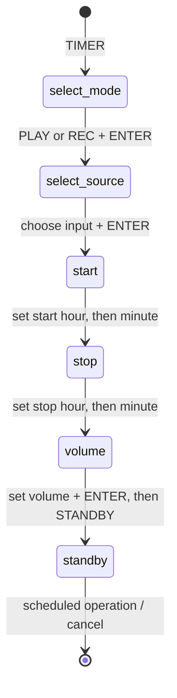

# Timer workflow and recognized states

The user manual's “Waking up to music” and “Timer-recording radio programs”
sections describe this sequence. Pressing ENTER advances; CANCEL, returning to
an earlier setting or re-entering setup can change the sequence, so the
receiver classifies the current display rather than assuming every step was
visited in order. It is passive and never sends a player command.

`LiveDisplay::timer_workflow(now_ms)` returns a typed `TimerWorkflow`, also
published as `timer_workflow` in `/api/state`:

| Field | Values | Meaning |
|---|---|---|
| `stage` | `select_mode`, `select_source`, `start`, `stop`, `volume`, `standby`, `unknown` | Current recognized display step |
| `mode` | `play`, `rec`, `unknown` | Selected timer type, when observed |
| `source` | `md`, `cd`, `radio`, `line`, `unknown` | Selected input, when observed in the current step |
| `editing` | `hour`, `minute`, `unknown` | Which time pair has been observed blanking |
| `fresh` | boolean | Whether the numeric bus has fresh data; it does not mean an unknown state is recognized |

The stage is `unknown` when the numeric bus is stale, or when the available
frames do not establish a specific timer step. In particular, it does not
invent a selected source in standby or infer a missed step from the prior
screen. The time and volume steps also require their corresponding fresh text
context. Source selection follows the source nibble blinking while PLAY or REC
remains selected; it retains the choice through the dark phase and requires a
transition within the last second. Disc indicators, track bytes and other
unrelated bits are not prerequisites. Confirmed time, volume and standby states
take priority. The TFT page uses the workflow stage to select its timer layout.

Observed evidence and limits:

- PLAY and REC mode selection: labelled flashing Saleae captures, including
  dark phases and transition frames.
- Wake source selection: RADIO, CD, MD and LINE user-guided C3 snapshots. PLAY may
  use zero or retained `FF FF 83` track bytes; the newest MD capture covers the
  retained version. With no MD, `live-timer-play-radio-source-no-md` shows
  byte2 `00` and track bytes `00 00 80`. LINE uses source bit `08`; its lit
  and dark phases were captured in `live-timer-play-line-source`.
- Timer REC source selection: RADIO and LINE user-guided C3 snapshots; LINE
  source bit `08` and both blink phases are in `live-timer-rec-line-source`.
- Start and stop time: captured MD, RADIO and CD wake examples, and RADIO timer
  REC, including hour/minute blanking where the user held those steps. The
  alphanumeric `On` / `Off` context distinguishes start from stop.
- Volume: captured MD, RADIO and CD wake examples and RADIO timer REC; the
  separate text command confirms this numeric layout.
- Standby: TIMER PLAY and TIMER REC clock layouts are captured. Timed start,
  actual stop and other unobserved transitions remain unknown until captured.

`captured_c3_snapshots` replays the user-guided snapshots and checks these
states and blink phases. `timer_workflow_transitions` checks the full
PLAY/REC setup sequence, cancellation/unknown and stale data.
`captured_timer_display` and
`captured_clock_readout` replay Saleae references and verify mode selection and
standby. C3 snapshots are latest-bus samples, not synchronized Saleae traces.
